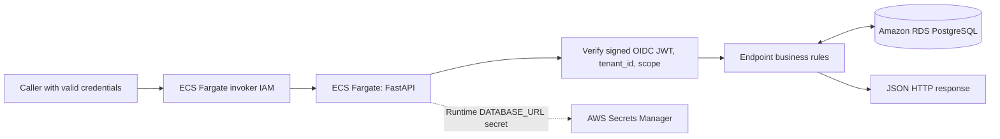
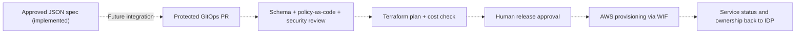

# LSK Internal Developer Platform

**Cloud deployment branch:** `feature/aws`. The service catalog uses `ecs-fargate-api` as the AWS API golden path. The application is hosted on ECS Fargate with Amazon RDS PostgreSQL, internal HTTPS ALB, and read-only Amazon Bedrock advisory/operations triage. See [Release Matrix](docs/RELEASE_MATRIX.md) and [AWS Deployment Guide](docs/DEPLOY_AWS.md). The catalog exports approved GitOps plans; **automatic cloud provisioning is still not implemented**. No live production deployment is claimed.


**Independent, fictional corporate IT lab built for Senior AI Platform Engineer interviews.** This is not evidence of an LSK or LSK production deployment.

[](https://github.com/nolet7/lsk-internal-developer-platform/actions/workflows/ci.yml)

## Goal

Replace ticket-driven developer infrastructure requests with a governed, reusable platform catalog. Application teams can request ECS Fargate API blueprints, managed PostgreSQL, and private-network connectivity. Platform reviewers control approvals and application teams receive a structured plan for a separately reviewed GitOps pipeline.

## Implemented

- Versioned golden paths: `ecs-fargate-api`, `managed-postgres`, `private-service-connectivity`
- Tenant-aware OIDC authentication and scopes: `catalog:read`, `platform:request`, `platform:read`, `platform:approve`, `platform:approve:prod`, `platform:plan`, `platform:audit`
- Idempotent request submission and PostgreSQL-backed requests, approvals and audit events
- Independent approval, explicit production-scope requirement, approval/rejection state machine
- Deterministic GitOps JSON plan export; **no direct cloud provisioning**
- Terraform for ECS Fargate, Amazon RDS PostgreSQL, AWS Secrets Manager, Amazon ECR and runtime IAM
- Docker Compose PostgreSQL, tests, lint, dependency audit and Terraform validation

## Local development

Create `.env` from `.env.example` and replace every placeholder with your own synthetic lab credentials / trusted OIDC provider. Passwords containing URL-special characters must be URL-encoded if embedded in `DATABASE_URL`; use an encoded DSN.

```bash
git clone https://github.com/nolet7/lsk-internal-developer-platform.git
cd lsk-internal-developer-platform
python -m venv .venv
source .venv/bin/activate
python -m pip install -r requirements-dev.txt
DATABASE_URL=sqlite+pysqlite:///./ci.db python -m pytest -q
```

To run the API with PostgreSQL:

```bash
docker compose --env-file .env up -d postgres
docker compose --env-file .env run --rm api python scripts/migrate.py
docker compose --env-file .env up -d api
```

Open the OpenAPI documentation at `http://localhost:8080/docs`. Use a valid access JWT issued by your configured OIDC provider. The API does not implement a fake authentication bypass outside tests.

## Service workflow

1. `GET /v1/catalog` — discover available golden paths.
2. `POST /v1/requests` — submit a typed request with `Idempotency-Key`.
3. `GET /v1/requests` — inspect tenant requests.
4. `POST /v1/requests/{id}/approve` — independent review, extra production scope.
5. `GET /v1/requests/{id}/gitops-plan` — export an approved, versioned plan for a protected GitOps repository.
6. `GET /v1/requests/{id}/audit` — inspect request events.

## Deploy to AWS

Follow **[docs/DEPLOY_AWS.md](docs/DEPLOY_AWS.md)** for a controlled AWS deployment. Set a budget before provisioning and remember that alerts do not cap spending. Amazon RDS PostgreSQL incurs costs even when ECS Fargate has zero instances. Terraform state and plans may contain sensitive credentials.

## Architecture and interview defense

- [Architecture and design decisions](docs/ARCHITECTURE.md)
- [AWS deployment guide](docs/DEPLOY_AWS.md)
- [Interview walkthrough](docs/INTERVIEW_DEFENSE.md)

## Boundaries and next work

This is an enterprise-style **lab foundation**, not a finished production portal. It does not yet create infrastructure PRs, deploy requested templates, or perform automatic cloud provisioning. An optional read-only Amazon Bedrock catalog advisory is implemented but does not authorize or execute changes. Before a regulated production use case, add reviewed migrations, private networking, durable audit integrity, policy-as-code, service ownership, backoff/concurrency/load tests, HA/DR, cost quotas, security assessment and observability SLOs.

Synthetic data only. No real customer or employer credentials.


---

## Shared AWS request path

The diagrams below describe the **deployed configuration**, not a claim that this repository is currently running in AWS. The local Docker Compose environment substitutes a local PostgreSQL container for Amazon RDS PostgreSQL.



**Trust boundaries and components:** internal HTTPS ALB determines whether a principal may invoke the deployed service. FastAPI **separately** checks a signed RS256 OIDC access JWT (issuer, audience, expiry, subject, tenant, and required scopes). An invoker identity token alone is not a substitute for the application's access token. Pydantic validates request bodies; the SQLAlchemy session reads/writes PostgreSQL with tenant filters. The application returns a synchronous JSON response. Terraform configures the ECS Fargate runtime service account, Amazon RDS PostgreSQL connection, AWS Secrets Manager and Amazon ECR; GitHub Actions builds/publishes containers through Workload Identity Federation. These CI/deployment components are **not** invoked by normal customer API calls.

**Operational endpoints:** `GET /healthz` responds without querying the database; `GET /readyz` queries the database. A local schema bootstrap is provided by `scripts/migrate.py`, not by incoming requests. Schema bootstrap is not a reviewed Alembic migration strategy.

**No frontend UI is included.** Use an authorized REST client or the FastAPI OpenAPI interface for the lab. No live employer integrations, real customer data, or real funds are involved.

## End-to-end request lifecycle: developer to approved GitOps handoff

**Use case:** A developer needs an internal service, managed database or private networking capability without opening a generic infrastructure ticket. The application delivers **catalog discovery, governed approval and a deterministic plan artifact**. Actual Terraform apply and PR creation are separate future integrations.

```mermaid
sequenceDiagram
  autonumber
  participant D as Developer
  participant I as internal HTTPS ALB
  participant A as FastAPI / OIDC / scopes
  participant DB as Amazon RDS PostgreSQL
  participant R as Reviewer
  participant V as Amazon Bedrock Amazon Bedrock (optional)
  D->>I: GET /v1/catalog
  I->>A: Permit invoker
  A->>A: Require catalog:read; select CATALOG
  A-->>D: 3 golden paths + versions/parameters
  opt User asks for explanation
    D->>A: GET /v1/ai/catalog-advisory/{template}
    A->>A: Check catalog:read and known template
    A->>V: Send approved catalog name/description
    V-->>A: Informational explanation
    A-->>D: advisory, authoritative=false, provisioned=false
  end
  D->>I: POST /v1/requests + Idempotency-Key
  I->>A: Permit invoker
  A->>A: Require platform:request; validate template, env, name, reason
  A->>DB: Check tenant/key/hash, insert pending + audit submitted
  DB-->>A: Request ID
  A-->>D: 201 pending or replayed=true
  R->>I: POST /v1/requests/{id}/approve
  I->>A: Permit invoker
  A->>A: Require platform:approve; forbid self approval
  opt Production request
    A->>A: Require platform:approve:prod
  end
  A->>DB: Lock row; update approved + audit approved
  DB-->>A: Commit
  A-->>R: approved, provisioned=false
  D->>I: GET /v1/requests/{id}/gitops-plan
  I->>A: Permit invoker
  A->>A: Require platform:plan + same tenant + approved state
  A->>DB: Read approved template/version/request
  DB-->>A: Approved request
  A-->>D: JSON GitOps spec + next_action (no deployment)
```

### How the request travels through each component

| Stage | Implemented component | What happens | Outcome |
|---|---|---|---|
| 1. Discovery | `GET /v1/catalog` / in-code `CATALOG` | Read-only approved `ecs-fargate-api`, `managed-postgres`, `private-service-connectivity` templates, version `1.0.0` | Golden-path selection |
| 2. Optional AI | `/v1/ai/catalog-advisory/{template_key}` -> `app/ai.py` -> Amazon Bedrock | With `catalog:read`, sends only allowlisted catalog description for explanation | Advisory response; **no decision** |
| 3. Request | `RequestIn`, `POST /v1/requests` | Validates template, DNS-style service name, `dev|stage|prod`, justification and header `Idempotency-Key` | Pending request |
| 4. Persistence | `PlatformRequest`, `AuditEvent`, SQLAlchemy | Insert tenant-scoped request and audit event in one transaction; unique tenant/idempotency-key; payload hash | Durable request ID |
| 5. Repeated submission | Hash and existing key lookup | Same requester and payload returns same request with `replayed:true`; different payload/actor returns 409 | No intentional duplicate submission |
| 6. Approval | `POST /v1/requests/{id}/approve` | Require `platform:approve`, independent approver, pending state; add `platform:approve:prod` for production | Approved record; **not provisioned** |
| 7. Rejection | `POST /v1/requests/{id}/reject` | Independent reviewer changes pending state to `rejected` | No GitOps export |
| 8. Export | `GET /v1/requests/{id}/gitops-plan` | Require `platform:plan`, same tenant, approved status; assemble versioned `PlatformRequest` JSON | Returned spec + `provisioned:false` |
| 9. Review history | `GET /v1/requests/{id}/audit` | Require `platform:audit` and same tenant | Submitted/approved/rejected events |

### Concrete developer example

Discover the catalog: `GET /v1/catalog` with `catalog:read`. Then submit:

```http
POST /v1/requests
Authorization: Bearer <DEVELOPER_OIDC_ACCESS_JWT>
Idempotency-Key: demo-idp-request-0001
Content-Type: application/json

{"template":"ecs-fargate-api","service_name":"customer-api","environment":"dev","justification":"Deploy customer self-service API for corporate IT"}
```

The API returns an `id`, `state:"pending"`, and `replayed:false`. A **different** reviewer with `platform:approve` calls `POST /v1/requests/REQUEST_ID/approve`. A production environment request additionally requires `platform:approve:prod`.

Once approved, an authorized user calls:

```http
GET /v1/requests/REQUEST_ID/gitops-plan
Authorization: Bearer <OIDC_ACCESS_JWT_WITH_platform:plan>
```

The JSON contains `apiVersion: platform.lsk.dev/v1alpha1`, `kind: PlatformRequest`, request ID, tenant, template key and version, chosen environment, fixed template parameters and network policy. The response explicitly says `provisioned:false` and instructs the user to submit the artifact into a **separately reviewed** infrastructure repository.

### What happens **after** plan export (not yet implemented)



Dashed connections are **planned steps**, not functional components. In particular, the current API **does not** open a GitHub PR, apply Terraform, create ECS Fargate services, create databases, or change VPC rules. `infra/` provisions the **IDP application's own hosting infrastructure** when applied manually; it is not an executor of requested golden paths.

### Security, errors and lifecycle limits

- Invalid/missing JWT: 401; missing scopes or tenant: 403; unknown template or invalid request: 422.
- Cross-tenant/unknown request: 404; unauthorized self approval: 403; already decided request: 409.
- Request key reused for a different payload or requester: 409; duplicate same payload returns `replayed:true`.
- No export for a pending/rejected request: 409; no external resources get created by approval alone.
- A catalog advisory model not configured returns 503, model failure returns 502; the normal platform workflow does not depend on the AI model.
- The in-code catalog is not yet versioned as independent template packages; there is no provisioning lifecycle/status callback, auto-expiry, cost quota, or drift reconciliation.


## Brixton JD alignment

Read [skill coverage and production readiness gaps](docs/JD_ALIGNMENT.md). The enterprise examples are fictional LSK portfolio workloads; they are not historical employer production deployments.

## Network infrastructure blueprint

The independent [LSK network golden path](blueprints/network/README.md) contains Terraform for a custom VPC, configurable subnet, optional Cloud NAT, and optional Private Service Access for cloud databases. It is **not** automatically executed by the IDP request workflow. A human must review any cloud costs, plans and networking changes.

## Privileged read-only AI incident triage

`GET /v1/ops/aws/{service_name}/triage` collects up to 25 ECS Fargate error-event metadata records from the previous hour (without raw log payloads) and asks Amazon Bedrock for investigation suggestions. It requires the `platform:ops:read` scope, a ECS Fargate service name explicitly configured in `LSK_OPS_ALLOWED_SERVICES`, and valid AWS identities/permissions. The allowlist defaults to empty, disabling this feature. It does not change infrastructure, issue IAM permissions, or establish incident root cause. See [JD alignment](docs/JD_ALIGNMENT.md).


## Multinational operating standard

See [docs/MULTINATIONAL_DEPLOYMENT.md](docs/MULTINATIONAL_DEPLOYMENT.md) for region isolation, tenant residency policy, deployment controls and outstanding readiness checks.

## Database migration process (updated)

This repository now uses **versioned Alembic migrations**, not `Base.metadata.create_all()` for cloud initialization. A dedicated PostgreSQL 16 CI job verifies the baseline schema and database-specific constraints. Run `python scripts/migrate.py` in a separately approved one-off job, **before** routing application traffic, and record the revision through `python -m alembic current`. For an existing database created by the earlier bootstrap, use the [brownfield migration checklist](docs/SCHEMA_MIGRATION.md) before changing it. Production deployment also requires backup/restore, private network, controlled change release and legal/region reviews.

## Private regional database connectivity

An opt-in [private Amazon RDS PostgreSQL + Direct VPC egress deployment](docs/PRIVATE_DATABASE_NETWORK.md) is available. Set `enable_private_sql=true` with a reviewed non-overlapping subnet CIDR. A `prod` Terraform plan now **requires** private SQL, REGIONAL HA and a non-micro Amazon RDS PostgreSQL tier. This is still a lab reference until a real AWS plan/apply, approved security review, failover test and backup restore have been completed.
