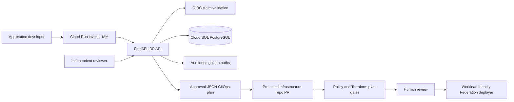

# LSK IDP — Enterprise-style architecture
## Business intent
Fictional enterprise corporate IT division serving Finance, Customer Operations and engineering teams. No manufacturing focus. Reduce ticket queues for standard Cloud Run APIs, managed databases, and reviewed network connectivity requests.

## System design

## Trust and authorization
Cloud Run IAM determines who can invoke the service. The app separately validates RS256-signed OIDC JWTs (issuer, audience, expiry, tenant_id, scopes). Tenant-bound database queries prevent cross-tenant API access. Reviewers cannot approve their own requests. Production requires a stronger approval scope. Structured audit events record changes. **A passing test is not a full security assessment.**

## Decision records
- Cloud Run instead of permanent GKE: cheaper idle footprint for portfolio labs, but does not demonstrate Kubernetes platform operations directly.
- Cloud SQL vs SQLite: transactional persistence and row-level locking; use PostgreSQL production behavior, not SQLite, for final concurrency tests.
- API produces reviewed GitOps plans rather than creating resources directly. The real infrastructure provisioning step is a separately governed integration.
- Golden paths are versioned catalog entries. The next release should move these into schema-validated repository templates, with security policy tests and protected PR generation.
- No LLM is connected. Optional AI assistant may recommend templates and explain review failures but must not approve, change IAM, or apply Terraform.

## Production gaps
Alembic migrations, provisioning adapter, OPA/Conftest, richer audit log integrity, cost controls, network policy validation, DB HA/restore drills, full OIDC end-to-end tests, multi-region failover, SLO telemetry, realistic load and concurrency testing, fine-grained service ownership and rate limiting.
