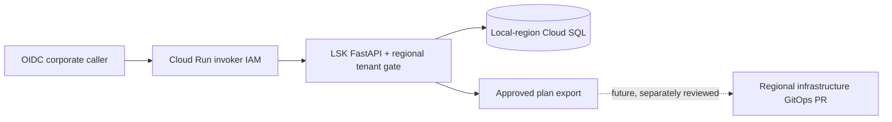

# LSK multinational deployment operating standard

This is an **independent synthetic enterprise lab**, not a production certification.

## Regional architecture

Deploy a separate GCP project and Terraform state per region, each with isolated Cloud Run, Cloud SQL, Secrets, IAM, logs and billing. Corporate OIDC must sign `tenant_id` and `data_region`; the backend checks both plus request scopes. In Terraform the runtime has `LSK_ENFORCE_RESIDENCY=true`, `LSK_DEPLOYMENT_REGION` and `LSK_TENANT_REGION_POLICY` generated from `tenant_region_policy`. The default allowlist is empty (deny all tenants until assignment). A missing configuration returns 503 and unauthorized region returns 403.



Example regional Terraform inputs using **synthetic** tenant identity:

```hcl
region = "europe-west1"
tenant_region_policy = {
  "demo-eu-business" = ["europe-west1"]
}
db_tier = "db-custom-2-7680"
db_availability_type = "REGIONAL"
```

The identity provider is responsible for accurate claims. Residency enforcement at the API is defense-in-depth: independent legal review, data replication policy, logs, model usage, backups, and regional network boundaries are required.

## Enterprise release gates

1. Legal/data team approves per-tenant jurisdiction, classification, deletion and transfer policy.
2. Security team reviews OIDC/RBAC, service identities, ingress, internal DNS, VPC, egress and threat model.
3. Platform deploys a reviewed immutable artifact using least privilege, protected branches and keyless GitHub OIDC.
4. DBAs run versioned migrations, enable tested backups/PITR, choose Cloud SQL HA-capable instance size and perform a restore drill.
5. Reliability team validates SLO dashboards, alert routes, p95 latency, controlled failure and rollback with evidence.
6. Audit team validates change approvals, access history and regulatory scope. No SOC2/ISO/GDPR/PCI certification is inferred.
7. Finance defines per-region budgets, monitoring and chargeback; budget alerts do not stop spend.

## IDP functionality boundary

The IDP exposes catalog, tenant-specific requests, audit records, human approvals and **JSON GitOps plan export**. It does **not** yet provision approved services, create GitHub PRs, or reconcile deployed cloud resources back to the catalog. Optional Gemini advice is read-only and requires explicit scopes.

Its optional networking blueprint is separate from the application Terraform. It does not automatically enforce secure private networking across all four repos.

## AWS and Azure branches

Current `feature/aws` and `feature/azure` branches predate this hardening. Forward-port the region gate and independently implement/test regional provider-specific controls before using those branches.

## Incomplete production concerns

Private Cloud SQL IP and egress controls, enterprise IdP integration, schema migrations, multi-region legal review, actual load/failover/restore evidence, SOC2/ISO control assessment, OPA policy tests, approved infrastructure PR pipeline and automatic service provisioning remain open.
